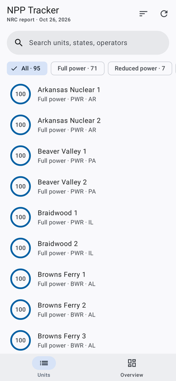
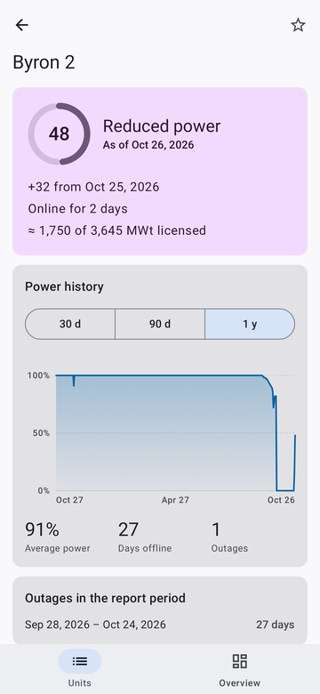
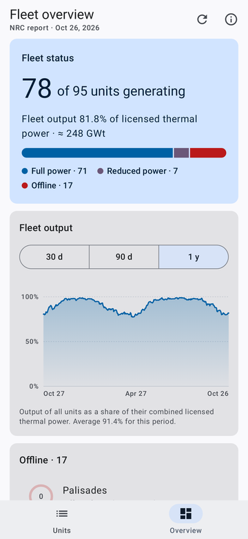
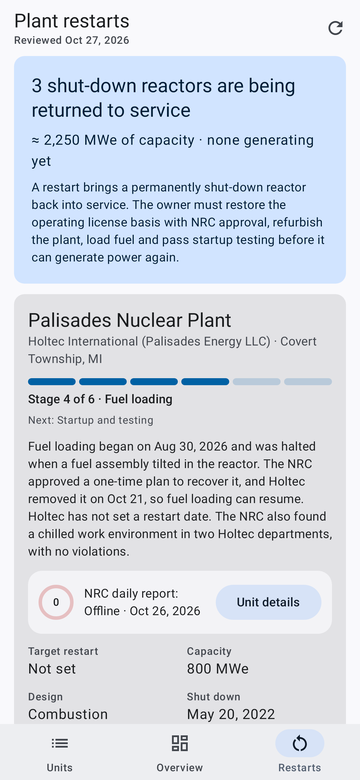
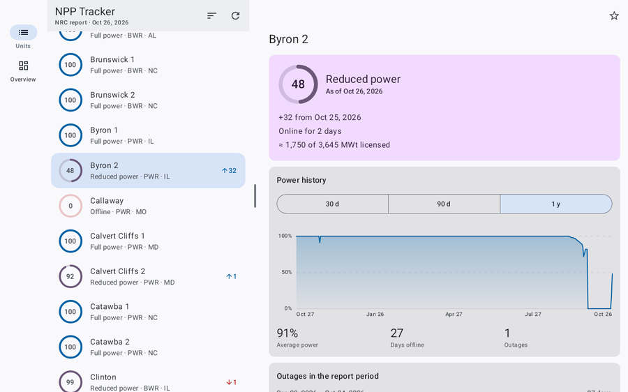
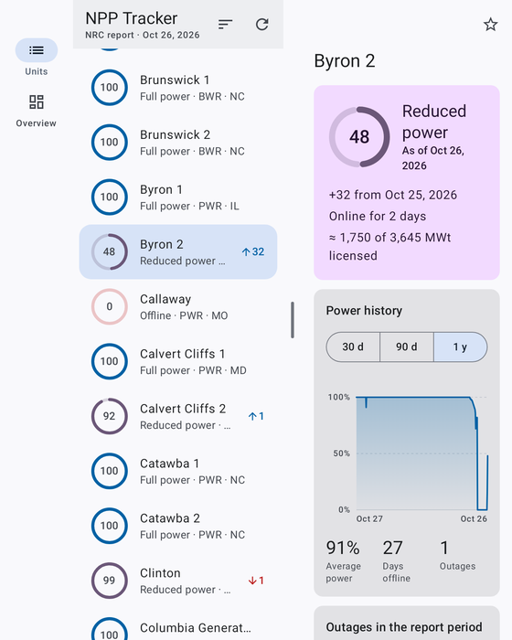

# NPP Tracker

An Android app that tracks the daily status of every commercial nuclear power reactor in the United States. It is built with Jetpack Compose and Material 3, and it adapts to phones, foldables and tablets.

<p>
  
  
  
  
</p>
<p>
  
</p>

## Features

- **All 95 licensed units** with their latest power level (percent of licensed thermal power), grouped as full power, reduced power or offline.
- **Search, filters and sorting**: by name, state, operator or vendor; filter by status or by starred units; sort by name, power, change or state.
- **Unit details**:
  - a 30-day, 90-day or 1-year power chart (tap or drag to read a day's value)
  - outage history and how long the unit has been online or offline
  - estimated thermal output, licensing data, vendor and containment type
  - other units at the same site, and links to the NRC unit page and a map
- **Fleet overview**:
  - how many units are generating, and fleet output weighted by licensed thermal power
  - the fleet output trend over the year
  - which units are offline or at reduced power, and what changed since the previous report
  - breakdowns by NRC region and reactor type
- **Plant restarts**: the shut-down reactors being returned to service (currently Palisades, Crane / Three Mile Island Unit 1 and Duane Arnold). For each one:
  - its stage, from announcement through NRC review, fuel loading and startup
  - a dated timeline of milestones, plus the target date, capacity, design, power buyer and federal financing
  - links to the sources and the NRC page
  - for a restart that already appears in the NRC daily report (Palisades), its live status and a link to its unit page; that unit is marked "Restarting" in the lists
- **Material 3 throughout**: dynamic color (Material You) on Android 12 and later, light and dark themes, edge-to-edge layout.
- **Works offline**: the last report is cached on the device, and pulling down refreshes it.

### Foldables and tablets

- The navigation bar becomes a navigation rail on wider windows.
- From medium width up (an unfolded foldable or a portrait tablet), the unit list and the unit details are shown side by side. The divider between them can be dragged, and the panes stay clear of a foldable's hinge.
- The overview cards flow into as many columns as fit.
- The selected unit, filters and scroll position are kept through rotation, resizing and fold/unfold.



## Install

Every push to `main` and every pull request runs the **Android build** workflow. To install the app:

1. Open the repository's **Actions** tab and pick the latest successful run.
2. Download the `npp-tracker-apk` artifact and unzip it.
3. Open `app-release.apk` on your device. You will need to allow installs from that source.

Requires Android 8.0 (API 26) or later.

The APK is signed with the shared key in `app/debug.keystore`, so each new build installs over the previous one without uninstalling. That key is public, which is fine for side-loading. If you ever publish to the Play Store, use a private key kept in GitHub Secrets instead.

## Build locally

You need JDK 17 or later and the Android SDK (Android Studio installs both).

```sh
./gradlew testDebugUnitTest   # unit tests
./gradlew assembleDebug       # debug build
./gradlew assembleRelease     # minified release build (app/build/outputs/apk/release/)
```

## Data sources

- **Power levels**: the NRC [Power Reactor Status Report](https://www.nrc.gov/documents-reports/document-collections/events-reports-associated-with/power-reactor-status-reports/ps). The app downloads the 365-day text file, which the NRC updates every day. The app refreshes it on launch when the cached copy is more than an hour old, and whenever you pull to refresh.
- **Unit details**: the NRC [list of operating power reactor units](https://www.nrc.gov/facilities-safety/operating-reactors/list-power-reactor-units) and each unit's NRC page. These are bundled in `app/src/main/assets/reactors.json`. When the NRC adds or removes a unit, regenerate the file:

  ```sh
  python3 tools/generate_reactors.py
  ```

  A unit that appears in the daily report but is missing from the bundled file still shows up, just without its details.
- **Restart projects**: curated by hand from NRC documents and news reports in `app/src/main/assets/restarts.json`. The app also downloads that file from this repository's `main` branch when it refreshes, so you can update the restart list by editing the file on GitHub, with no new build. If the downloaded copy's `updated` date is older than the copy built into the app, the built-in one is used, so bump that date with each edit. The unit tests check the file, so a malformed edit fails the build. Each project has a `stage` (`announced`, `nrc_review`, `approved`, `fuel_load`, `startup` or `operating`) and a list of milestones. A milestone date can be `yyyy-MM-dd`, `yyyy-MM`, a year, a phrase such as `Early 2029`, or empty.

Power is reported as a percentage of licensed thermal power as of the morning of the report date. Thermal output figures are estimates (licensed MWt × reported power). This project is not affiliated with or endorsed by the NRC.

## Project layout

```
app/src/main/java/io/github/l0gic0l/npptracker/
├── data/          NRC download and cache, report parser, unit and fleet statistics, restart projects
├── ui/
│   ├── NppApp.kt        app shell: adaptive navigation suite, about dialog
│   ├── NppViewModel.kt  state, filtering, sorting, starred units
│   ├── units/           list/detail pane scaffold, list pane, detail pane
│   ├── overview/        fleet dashboard
│   ├── restarts/        plant restart projects
│   ├── components/      power ring, chart, cards, formatting
│   └── theme/           Material 3 theme (dynamic color with a fallback scheme)
tools/generate_reactors.py   regenerates the bundled unit details
```
